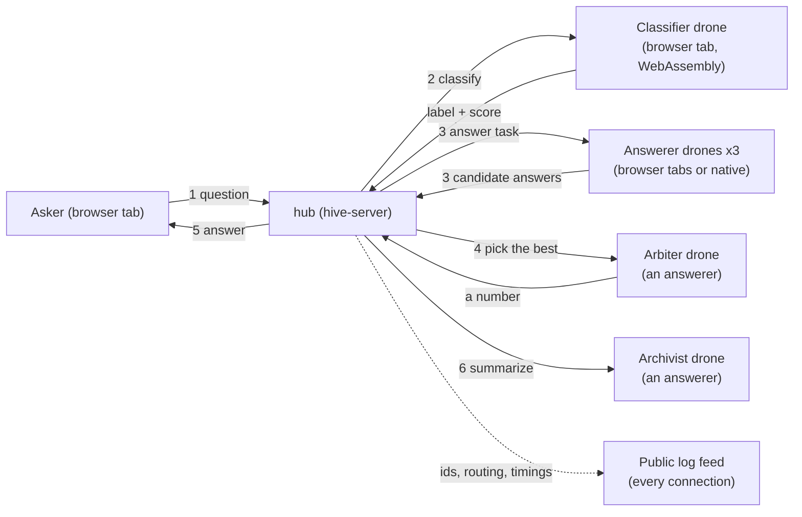

# hive-server

The hub of the Hive.

The Hive is a swarm of small language models running in people's browser tabs. Anyone can open the page, watch the swarm work in a live log, ask it a question, or join it as a drone that lends its tab to answer other people's questions. There is no large model behind it and no inference on the server: every answer is produced by the small models of the drones that are connected at that moment.

This repo is the hub: a Rust WebSocket server that connects the drones, turns each question into tasks for them, and broadcasts a public log of what moves through the swarm. It never runs a model. The page and the native drone live in the sibling repo, [hive-client](https://github.com/idle-intelligence/hive-client). You need both to see the Hive work.

## Architecture



The hub knows two kinds of drone, told apart by the capabilities a drone declares when it registers:

- A **tagger** runs a small text classifier, compiled to WebAssembly, in the page. It labels each question `swarm`, `time`, `weather` or `other`, with a score.
- An **answerer** runs a small instruct language model (in the browser or in the native drone from hive-client) and answers whatever task the hub sends it. Answering, arbitrating, telling the time and archiving are all tasks of this one kind, which differ only in the prompt.

A page that has both ready registers with both capabilities.

### How a question flows

1. The asker sends a question over the WebSocket. The hub gives it an id and logs that a message of N characters arrived.
2. The hub sends the question to one tagger as a `classify` task (3 second limit). The label counts only at a score of 0.6 or more. A `time` question is rewritten as a time task. A `swarm` question, which asks about the swarm itself, is only answered for askers who have joined, and the hub adds the swarm's current statistics to the prompt. Any other result, no tagger, or a tagger that times out, falls back to a plain answer.
3. The hub picks up to three idle answerers at random and sends each the question as an `answer` task. No drone gets two tasks at once.
4. With three candidate answers, the hub picks a fourth answerer as arbiter. It is shown the question and the candidates and replies with a number, at temperature 0. With only one or two answerers available, the first answer is delivered as it arrives.
5. If the tasks do not finish within 12 seconds, the hub answers with what it has, or tells the asker that nobody could answer.
6. The hub sends the asker the answer along with the id of the drone that wrote it, the tokens produced and the time taken.
7. The hub queues an archivist task: an answerer summarizes the exchange in five words, at temperature 0. In this version the summary is only logged by length; filing it into a store is not part of this repo.

Work that has no asker goes through the same machinery. Once a minute the hub sends one answerer the current time and asks it to say it in its own words, and once a minute it logs statistics about the swarm (drones, models, speeds, estimated compute). When no answerer is free, tasks wait in a queue. The queue for questions is served before the one for the clock and the archivist.

### Messages

Everything on the wire is JSON with a `type` field. Drones and pages send `register`, `heartbeat`, `message` (a question), `result` and `task_failed`. The hub sends `task`, `response`, `log` and `error`. The hub limits a connection to 64 KiB per WebSocket message, a question to 20 turns of at most 1000 characters, and checks every number a drone reports about itself. Names a peer supplies are reduced to a safe set of characters before they reach the log. The definitions are in `src/protocol.rs` and `src/validate.rs`.

## Principles

1. **Small on purpose.** What looks missing is left out by design: no database, no accounts, no search, no framework, no settings beyond the few listed here.
2. **No special cases.** One rule for every message, every peer and every cell. A fix that needs an `if` for one situation is the wrong fix.
3. **The hub stays dumb.** It routes messages, tracks peers, writes and reads files, and broadcasts log lines. It never runs a model and never decides what a drone could decide.
4. **Every job is a task for the swarm.** Answering, judging, classifying, archiving and telling the time are all tasks sent to drones.
5. **The public sees the transport, never the words.** The feed shows ids, routing, character counts and timings. What a user typed, and the answer they got, go only to that user. Text no user was involved in, like the hive's own time sentence, may be shown.
6. **Drones pick their engine by what the device can do,** never by device name, and nothing is tuned per device.
7. **Simple words** in logs, messages, comments and docs.

The design also fixes how the swarm's memory will work, once it exists: storage is one JSONL file per cell and nothing else, no database; retrieval is by tags and recency, with no embeddings and no index; and the memory adds to the model's knowledge and never replaces it. Memory, and a larger classifier that files each question into a cell of a topic grid, are planned and are not in this repo.

## Run it

You need the Rust toolchain; `rust-toolchain.toml` pins version 1.93.0.

```
cargo run --release
```

The hub listens on `ws://0.0.0.0:8080/ws` and prints its log to standard output. Then start the page from hive-client and open it (its README has the commands). To add a drone without a browser, run the native drone from hive-client.

## Configuration

All settings are optional environment variables.

| Variable | Default | Meaning |
| --- | --- | --- |
| `HUB_HOST` | `0.0.0.0` | Address to listen on. |
| `HUB_PORT` | `8080` | Port to listen on. |
| `HUB_ALLOWED_ORIGINS` | unset | Web pages allowed to connect, as a comma-separated list of exact origins such as `https://example.org`. `*` allows every origin. Unset allows pages served from localhost only. Connections that send no `Origin` header, like the native drone, are always accepted. |

The hub speaks plain `ws://`. To serve it over the internet, put a TLS-terminating proxy or tunnel in front of it and set `HUB_ALLOWED_ORIGINS` to the origin of your page.

## Check it

```
scripts/ci.sh
```

runs the format check, clippy, the tests and the release build. The tests start real hubs and connect fake drones to them.

## Code

- `src/hub.rs`: routing, tasks, queues, timeouts, the clock.
- `src/router.rs`: choosing drones by capability and availability.
- `src/state.rs`: peers, pending messages, queues.
- `src/protocol.rs`: the messages exchanged with the page.
- `src/log.rs`: every public log line.
- `src/validate.rs`: limits and checks on what peers send, and the origin policy.

## Licence and citation

Apache-2.0. See `LICENSE` and `NOTICE`. If you use or build on this software, cite it with the metadata in `CITATION.cff` (GitHub shows a "Cite this repository" button from it).
